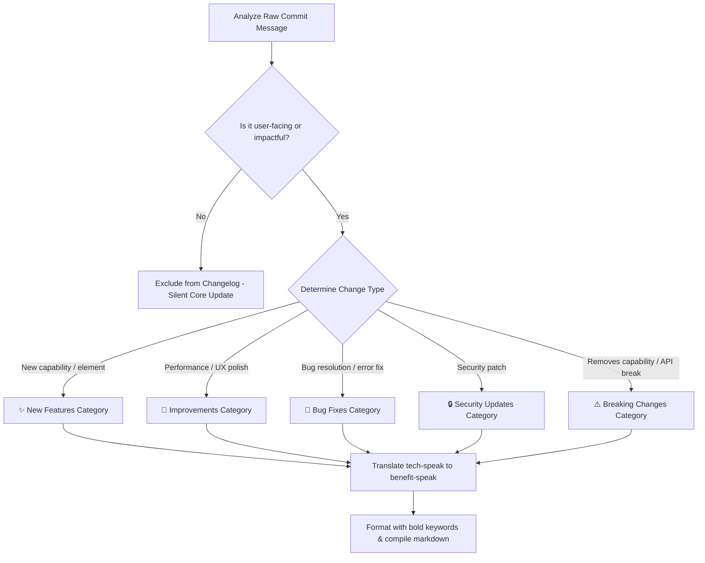

---

name: changelog-generator

description: |

  技術的な生 git コミットを顧客向けの整形されたリリースノート・changelog に変換する。デプロイ版準備、クライアント向け更新案、週次エンジニアリングまとめ、`CHANGELOG.md` 編集時に起動。キーワード: git log, commit hash, SemVer, CHANGELOG.md, release notes, commit parser。

license: Complete terms in LICENSE.txt

---

# プロ向け Changelog ジェネレーター

開発者向けの生 git ログを読みやすく構造化されたユーザー向け changelog に変換するスキル。

> [!NOTE]
>
> 自己完結型スキル。ユーザーがローカルスタイルテンプレート（`CHANGELOG_STYLE.md` など）の利用を明示しない限り、外部ファイルやディレクトリを参照しない。

---

## 考え方と翻訳フレームワーク

生コミットを変換するとき自問する:

* **価値の視点**: エンドユーザーへの価値は？（例: "Refactored sql query optimization" → "アプリ読込速度を最大 40% 改善"）
* **内部情報露出リスク**: インフラ詳細、脆弱性、DB スキーマ、サーバー名を晒していないか
* **ノイズ除去**: chore、test、パイプライン微調整、typo など顧客価値ゼロのコミットは除外

---

## 意思決定ツリー: 変更分類とフォーマット

---

## 翻訳ヒューリスティック: Dev-Speak vs Customer-Speak

| Raw Developer Commit Message | Target Customer-Speak Translation | Category | Reason for Translation |
| :--- | :--- | :--- | :--- |
| `feat: added redis caching layer to getAccounts` | **ダッシュボード高速化**: アカウント・プロフィールページの応答を高速化。 | Improvements | ユーザーは "Redis" より速度を重視。 |
| `fix: resolved null pointer exception in Stripe webhook handler` | **Stripe 決済の信頼性**: チェックアウトでサブスクが有効化されないことがあるエラーを修正。 | Bug Fixes | "Null pointer" は技術用語。ビジネス影響を説明。 |
| `chore: updated jest configs and package.json lock` | *除外* | N/A | テスト基テスト基盤は顧客価値ゼロ。 |
| `refactor: extract user verification middleware` | **アカウントセキュリティ強化**: 不正セッション共有を防ぐ認証をアップグレード。 | Security | リファクタをセキュリティ信頼に翻訳。 |

---

## 制約と自由度の調整

* **低自由度（形式・構造）**:
  * **構造**: `✨ New Features`、`🔧 Improvements`、`🐛 Bug Fixes`、`🔒 Security`、`⚠️ Breaking Changes` に分類
  * **機密**: ホスト名、DB 構造、ハッシュ、開発者名の露出は禁止

* **高自由度（トーン・コピー）**:
  * **ブランド voice**: 企業トーン（カジュアル / 堅牢 / OSS 技術向けなど）に合わせ自由

---

## 絶対に避けるアンチパターン

| してはいけないこと | 結果 | 理由 |
| :--- | :--- | :--- |
| **NEVER** 開発コミットをそのまま貼る | 読めないコード名・typo の壁 | changelog はプロダクトコミュニケーション |
| **NEVER** API キー・パス・内部名を漏らす | 攻撃面の露出 | 内部構成は常に抽象化 |
| **NEVER** bug fix を "New Features" に混ぜる | 進捗誤認・信頼低下 | 分類の透明性 |
| **NEVER** 時系列確認なしで生成 | 版との対応が不明 | 新しい順に並べる |

---

## ステップバイステップ生成手順

### Step 1: Git 履歴の抽出

例: `git log --pretty=format:"%s (%an)" v1.1.0..v1.2.0`

### Step 2: フィルタとソート

`Merge branch 'main'`、CI/CD、テストログを除外。残りをカテゴリにグループ化。

### Step 3: Benefit-Speak への翻訳

ヒューリスティックを適用。ビジネス価値・問題解決を強調する動詞に変換。

### Step 4: 整形とレビュー

Markdown 構文確認。絵文字ヘッダ追加。日付または SemVer で構造化出力。

---

## エラー処理と乱雑ログのフォールバック

* **空の git log**: リポ未初期化、誤タグ、ルート外実行 → リポ確認。空なら `mtime` と `git diff` にフォールバック
* **無意味メッセージ** ("fixed stuff", "wip"): `git show <commit_hash>` で差分から実装を合成
* **版タグ欠落**: SemVer 未使用 → 直近 7 日 / 30 日など日付範囲にフォールバック