---

name: mermaid-diagrams

description: |

  Mermaid 構文で図や可視化を作成する。フローチャート、シーケンス図、クラス図、ER 図、ガントチャート、各種ドキュメント用の図を生成するときに使う。トリガー: Mermaid, flowchart, sequence diagram, class diagram, ER diagram, Gantt chart, diagram, visualization。


  Mermaid 構文で図や可視化を作成する。フローチャート、シーケンス図、クラス図、ER 図、ガントチャート、各種ドキュメント用の図を生成するときに使う。トリガー: Mermaid, flowchart, sequence diagram, class diagram, ER diagram, Gantt chart, diagram, visualization。


---


# Mermaid 図


Mermaid の markdown 構文で図や可視化を作成する。


## クイックリファレンス


Mermaid 図は言語識別子 `mermaid` 付きの markdown コードブロックに書く。


## フローチャート


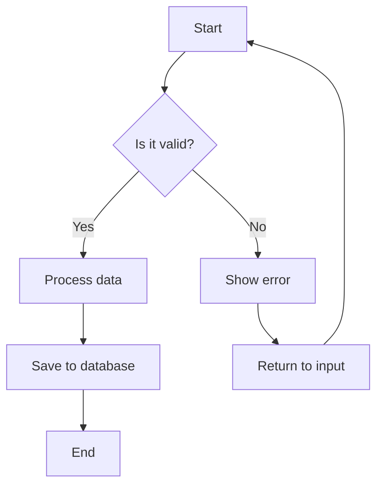


### フローチャート構文

```

flowchart TD          %% TD = top-down, LR = left-right, RL, BT

    A[Rectangle]      %% Square brackets = rectangle

    B(Rounded)        %% Parentheses = rounded rectangle

    C{Diamond}        %% Curly braces = diamond/decision

    D[[Subroutine]]   %% Double brackets = subroutine

    E[(Database)]     %% Cylinder shape

    F((Circle))       %% Double parentheses = circle

    G>Asymmetric]     %% Flag shape


    A --> B           %% Arrow

    B --- C           %% Line without arrow

    C -.-> D          %% Dotted arrow

    D ==> E           %% Thick arrow

    E --text--> F     %% Arrow with label

    F -->|label| G    %% Alternative label syntax

```


### サブグラフ

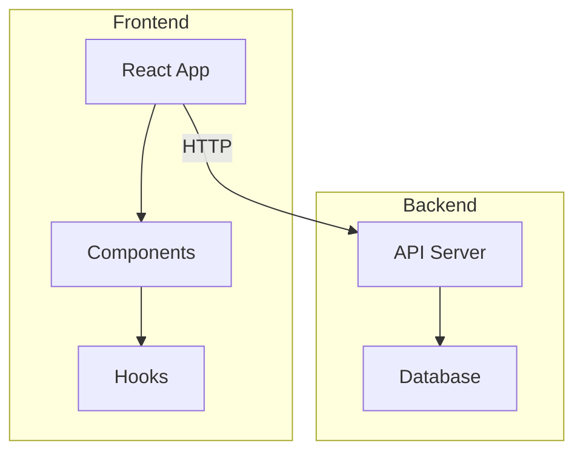


## シーケンス図


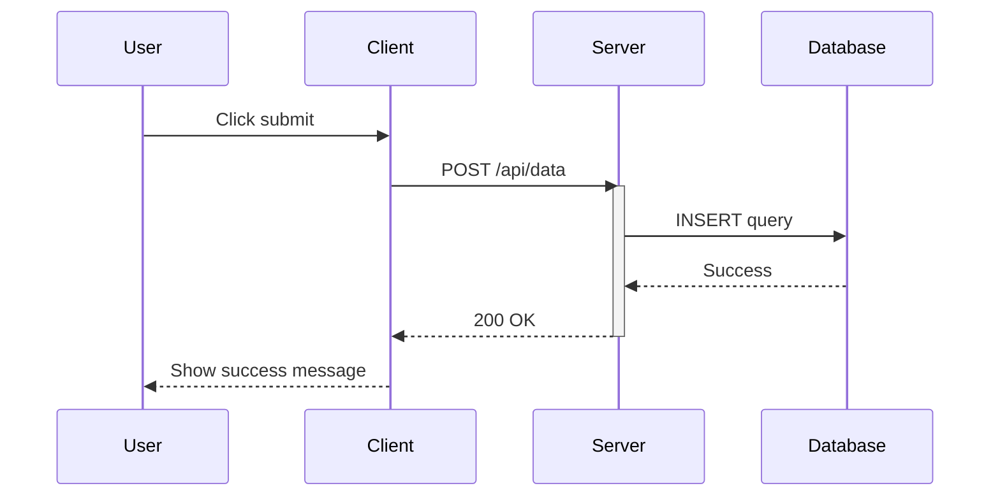


### シーケンス図構文

```

sequenceDiagram

    participant A as Alice

    participant B as Bob


    A->>B: Solid line with arrow

    A-->>B: Dotted line with arrow

    A-)B: Solid line with open arrow

    A--)B: Dotted line with open arrow

    

    activate B          %% Activation box

    B->>A: Response

    deactivate B

    

    Note over A,B: This is a note

    Note right of A: Note on right

    

    alt Condition true

        A->>B: Do this

    else Condition false

        A->>B: Do that

    end

    

    loop Every minute

        A->>B: Ping

    end

    

    opt Optional action

        A->>B: Maybe do this

    end

```


## クラス図


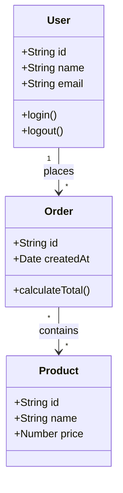


### クラス図構文

```

classDiagram

    class ClassName {

        +publicField

        -privateField

        #protectedField

        ~packageField

        +publicMethod()

        -privateMethod()

    }

    

    ClassA <|-- ClassB : Inheritance

    ClassC *-- ClassD : Composition

    ClassE o-- ClassF : Aggregation

    ClassG --> ClassH : Association

    ClassI ..> ClassJ : Dependency

    ClassK ..|> ClassL : Realization

```


## エンティティ関係図


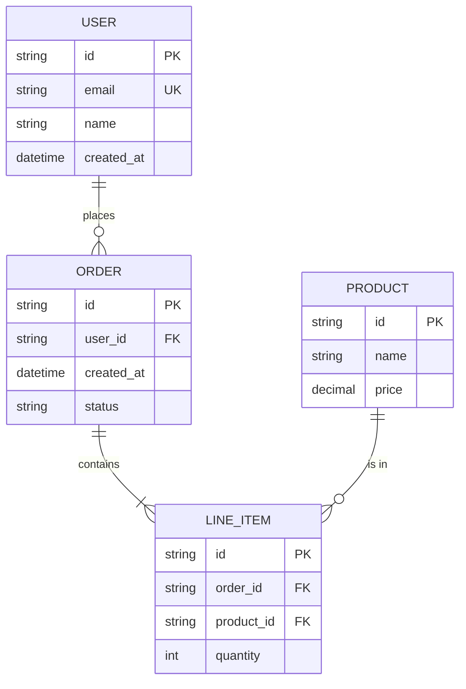


### ER 図のカーディナリティ

```

||--||   One to one

||--o{   One to zero or more

||--|{   One to one or more

}o--o{   Zero or more to zero or more

```


## ガントチャート


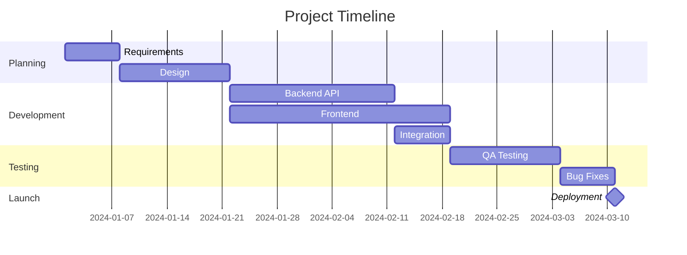


## 状態図


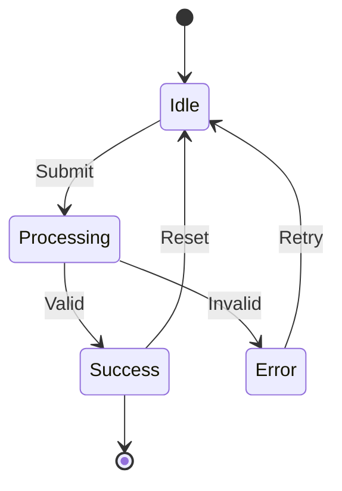


## 円グラフ


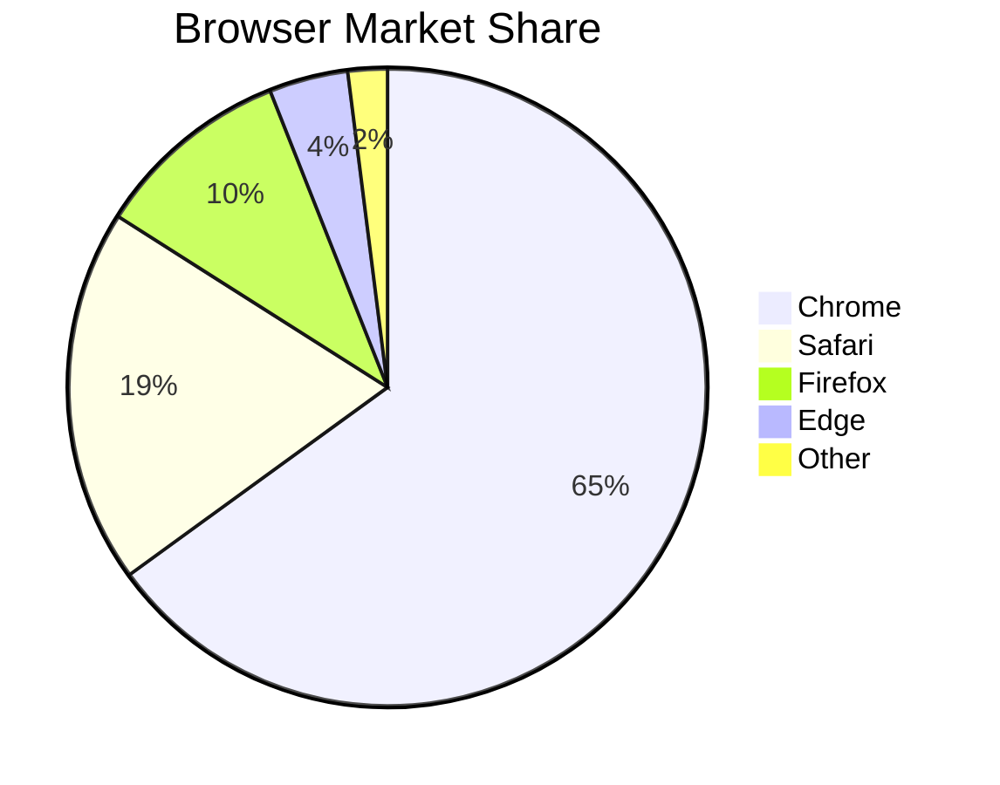


## Git グラフ


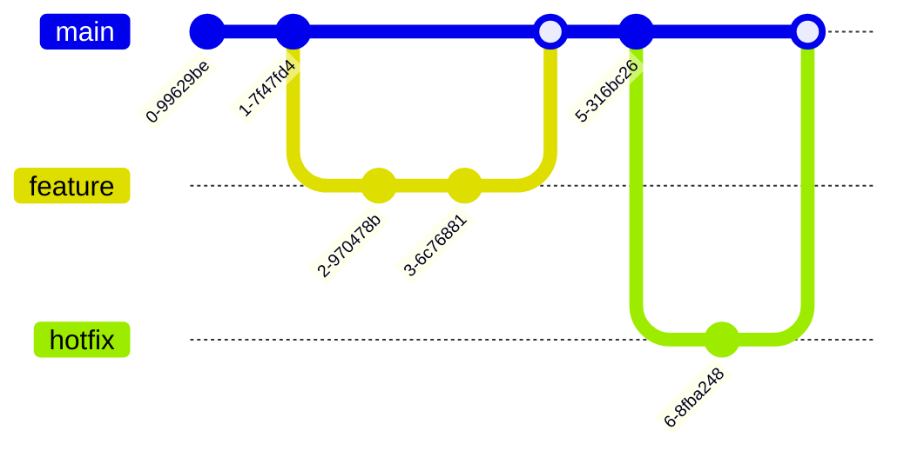


## ユーザージャーニー


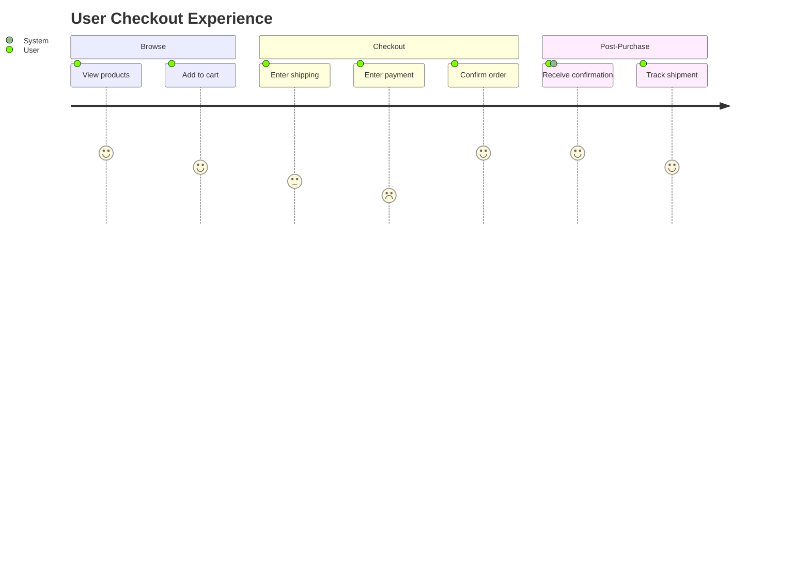


## マインドマップ


```mermaid

mindmap

    root((Project))

        Frontend

            React

            TypeScript

            Tailwind

        Backend

            Node.js

            PostgreSQL

            Redis

        DevOps

            Docker

            Kubernetes

            CI/CD

```


## スタイリング


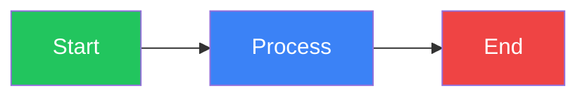


## React コンポーネント


```tsx

import mermaid from 'mermaid';

import { useEffect, useRef } from 'react';


mermaid.initialize({

  startOnLoad: true,

  theme: 'neutral', // default, dark, forest, neutral

  securityLevel: 'loose',

});


interface MermaidProps {

  chart: string;

  id?: string;

}


export function Mermaid({ chart, id = 'mermaid-diagram' }: MermaidProps) {

  const ref = useRef<HTMLDivElement>(null);


  useEffect(() => {

    if (ref.current) {

      mermaid.render(id, chart).then(({ svg }) => {

        if (ref.current) {

          ref.current.innerHTML = svg;

        }

      });

    }

  }, [chart, id]);


  return <div ref={ref} className="mermaid-container" />;

}


// Usage

<Mermaid

  chart={`

    flowchart LR

      A --> B --> C

  `}

/>

```


## ヒント


1. **方向**: `TD`（上から下）、`LR`（左から右）、`BT`（下から上）、`RL`（右から左）を使う

2. **コメント**: コメントには `%%` を使う

3. **引用符**: 特殊文字を含むラベルは引用符で囲む: `A["Label with (parentheses)"]`

4. **改行**: 複数行ラベルには `<br/>` を使う


## リソース


- **ライブエディタ**: https://mermaid.live

- **GitHub サポート**: Mermaid は GitHub markdown でネイティブに動作する


## アンチパターン


| 避ける | 理由 | 代わりに |

|-------|-----|---------|

| ラベル内の特殊文字を引用符なしで使う | ノード構文エラーで描画が止まる（括弧や角括弧など） | 特殊文字を含むラベルは常に引用符で囲む。例: `id["Label (Extra Info)"]` |

| 一枚岩の複雑なチャート | 25 ノード超のグラフは視認できなくなる | 密な図を論理的なサブグラフに分割 |

| ラベル内の HTML 要素 | markdown パーサーインターフェースを壊す | ノードテキストに生 HTML タグを埋め込まない |


## 参照


**必須 - 自己完結ディレクティブ**:

自己完結スキルである。このワークフロー実行中に明示的に作成されない限り、外部ファイルの読み込みやディレクトリ参照をしない。


