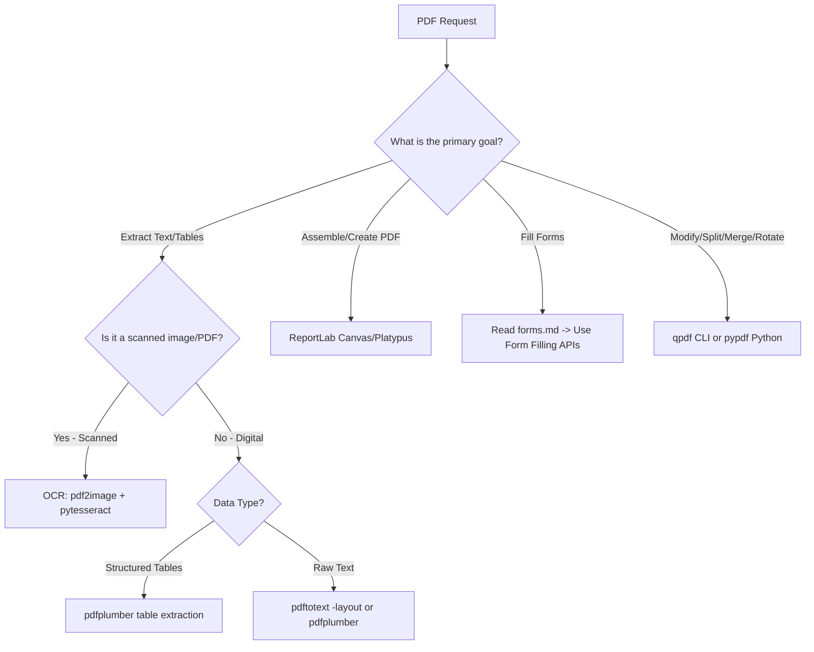

# PDF 処理ガイド

コマンドラインツールと Python/JS ライブラリで PDF のパース、作成、編集、変換を行う。

---

## 1. リファレンス読み込みと段階的開示

追加リファレンスドキュメント:
- **AcroForm とフォーム入力**: 先に [forms.md](file:///home/jsoehner/yuv-skills-backup/document-skills/pdf/forms.md) を**必ず**全文読む。
- **高度な PDFium2 / JS (pdf-lib)**: [reference.md](file:///home/jsoehner/yuv-skills-backup/document-skills/pdf/reference.md) を**必ず**全文読む。
- これらを読むとき **range 制限を設定しない**。

---

## 2. トリガーシナリオと決定木

### ワークフロー決定木



---

## 3. 制約と自由度の調整

*   **フォームフィールド名（低自由度）**: 入力時は AcroForm 辞書キーと完全一致が必要。綴りや大文字小文字を変えると値が入らない。
*   **座標系（低自由度）**: PDF キャンバスは 72 points/inch、原点 `(0,0)` はページ左下。文字配置はここから手動計算する。
*   **コンテンツ生成レイアウト（中自由度）**: ReportLab では `Platypus`（`Paragraph`、`Table`、`Spacer` など）で自動ページ割り当て。証明書や1ページフライヤーなど絶対配置のみ `canvas` 直接描画。

---

## 4. エキスパート知識デルタ

### グリッドとキャンバス座標（72 points/inch）

ReportLab キャンバスはポイント単位。Letter（8.5 × 11 inch）なら 612 × 792 points。明示的マージンで設計:
- 左マージン: $54\text{ pt}$ ($0.75\text{ in}$)
- 右境界: $612 - 54 = 558\text{ pt}$
- 上境界: $792 - 54 = 738\text{ pt}$

`drawString` でオーバーフローを避ける:

```python
# BAD: Drawing arbitrary text without wrapping
canvas.drawString(100, 700, "A very long sentence that will overflow the page boundary...")

# GOOD: Using Paragraph style for auto-wrapping within layout boundaries
from reportlab.platypus import Paragraph
from reportlab.lib.styles import ParagraphStyle

style = ParagraphStyle('Normal', fontSize=10, leading=12)
p = Paragraph("A very long sentence that will wrap correctly.", style)
p.wrapOn(canvas, 458, 100) # Wrap text width = 458 pt (558 - 100)
p.drawOn(canvas, 100, 700)
```

---

## 5. マインドセットと実行手順

### 自己点検チェックリスト

*   *デジタル PDF かスキャンか？（テキストストリーム読取で空なら OCR へ）*
*   *表抽出か？ `pdfplumber` デフォルトか `table_areas` 調整か？*
*   *レポート作成で `SimpleDocTemplate` でヘッダー/フッターを自動化すべきか？*
*   *暗号化されていないかセキュリティ設定を確認したか？*

### ステップ実行シーケンス

1.  **検査**: `qpdf --show-pages` または `pypdf` で `len(reader.pages)`。
2.  **抽出 / 入力**:
    *   テキスト: `pdftotext -layout input.pdf output.txt`。
    *   フォーム: `forms.md` を読み、フィールド名取得、Python 入力スクリプト作成。
3.  **コンパイル / 生成**:
    *   ReportLab でスクリプト作成。小さなモックデータで書式テスト。
4.  **検証**: `pdftoppm` で画像化しレイアウト確認。

---

## 6. アンチパターンと禁止事項

| Action | Why Avoid It | Correction/Alternative |
| :--- | :--- | :--- |
| **NEVER** 抽出テキストが視覚的読取順であると仮定する。 | PDF は論理フローではなくストリーム命令で描画される。 | `pdftotext -layout` または `pdfplumber.extract_text(layout=True)`。 |
| **NEVER** Font と Leading を設定せず Canvas に文字を描く。 | デフォルトが小さすぎたり重なる。 | 描画前に `canvas.setFont("Helvetica", 10)`。 |
| **NEVER** バックアップなしに既存 PDF を上書きする。 | 途中クラッシュでソース破損。 | `input_filled.pdf` など別名で出力。 |
| **NEVER** 高解像度ベクター PDF に OCR だけを使う。 | 遅く、直接抽出より精度が低い。 | まずプログラム抽出、空なら OCR。

---

## 7. エラーシナリオとフォールバック

### 空のテキスト抽出

*   *シナリオ*: `page.extract_text()` が空だが画面上は文字あり。
*   *フォールバック*: スキャンまたはカスタムフォントの可能性。`pdf2image` + `pytesseract` で OCR。

### フォームフィールドが表示されない

*   *シナリオ*: スクリプトは成功するがビューアで空白。
*   *フォールバック*: AcroForm `/NeedAppearances` を `True` にするか、入力後に flatten。

### ReportLab Platypus の余分な改ページ

*   *シナリオ*: わずかに長すぎて末尾に空白ページ。
*   *フォールバック*: `Spacer` 縮小、`ParagraphStyle` の余白調整、`KeepTogether` で見出しと本文を分割抑止。