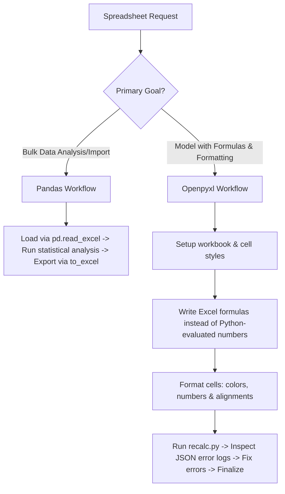

# スプレッドシートの作成・編集・分析

openpyxl、pandas、ヘッドレス LibreOffice マクロを用いて Excel スプレッドシートの構築、パース、更新、再計算を行う。

---

## 1. リファレンス読み込みと段階的開示

自己完結型のスキルフォルダです。
- ローカル [recalc.py](recalc.py) で計算と検証を実行する。
- 明示されない限り外部リファレンスファイルを探さない。

---

## 2. トリガーシナリオと決定木

### ワークフロー決定木



---

## 3. 制約と自由度の調整

*   **Excel 数式（低自由度）**: Python で結果を計算して値を書き込まない。動的なシート状態を保つためセルには実際の数式文字列（例: `=SUM(B2:B9)`）を書く。
*   **財務モデル色コード（低自由度）**: 標準色: 入力は青文字、数式は黒、内部リンクは緑、外部ファイルは赤、ハイライトは黄背景。
*   **データ構造（中自由度）**: 通貨単位を含むヘッダーで表を明確に配置。ソートが必要な表では縦書きや結合セルを避ける。

---

## 4. エキスパート知識デルタ

### 業界財務モデル標準と書式

#### 色コード

- **青文字 (RGB: 0,0,255)**: ハードコード入力とシナリオパラメータ。
- **黒文字 (RGB: 0,0,0)**: 数式と計算。
- **緑文字 (RGB: 0,128,0)**: シート間参照。
- **赤文字 (RGB: 255,0,0)**: ブック間リンク。
- **黄背景 (RGB: 255,255,0)**: レビューが必要なハイライトセル。

#### 書式パターン

- **倍数**: `0.0x`（例: Valuation Multiples EV/EBITDA）。
- **パーセント**: `0.0%`（小数第1位を常に含める）。
- **負数**: `-123` ではなく括弧 `(123)`。
- **ゼロ**: ダッシュ `-` 表示: `_($* #,##0_);_($* (#,##0);_($* "-"_);_(@_)` など。

---

## 5. マインドセットと実行手順

### 自己点検チェックリスト

*   *数式を書いているか？ LibreOffice で `recalc.py` を実行し値を埋め数式エラーをスキャンできるか確認したか？*
*   *入力（ハードコード）と計算（数式）を別セルに分離したか？*
*   *ヘッダーに単位（例: "Revenue ($mm)"）を明記したか？*
*   *インライン定数（`=B5*1.05`）ではなく相対数式（`=B5*(1+$B$6)`）を使ったか？*

### ステップ実行シーケンス

1.  **モデル構造の草案**:
    *   Assumptions、Calculations、Output Summaries にシート/セクションを分ける。
2.  **実装（openpyxl）**:
    *   ワークシート構築。数式文字列を書く。
    *   フォント、塗りつぶし、配置、数値書式を適用する。
3.  **再計算（必須）**:
    *   実行: `python recalc.py output.xlsx`
4.  **エラー修正**:
    *   出力 JSON で `#REF!`、`#DIV/0!`、`#VALUE!`、`#NAME?` を確認する。
    *   インデックスや参照を調整し、成功するまで `recalc.py` を再実行する。

---

## 6. アンチパターンと禁止事項

| Action | Why Avoid It | Correction/Alternative |
| :--- | :--- | :--- |
| **NEVER** 数式で表現できるものに計算済み値だけを書く。 | 再計算やインタラクティブ性を損なう。 | `=SUM(...)` や `=AVERAGE(...)` などを書く。 |
| **NEVER** 編集目的で `data_only=True` で openpyxl 保存する。 | 数式が消え値だけになる。 | 読み取り時のみ `data_only=True`；書き込み時は `False`。 |
| **NEVER** 数式適用後に `recalc.py` をスキップする。 | 未計算セルや潜在エラーが残る。 | 保存後に `recalc.py` を実行する。 |
| **NEVER** 数式内に定数をハードコード（例: `=A1*1.08`）。 | パラメータが見えずシナリオ調整が困難。 | 別の前提セルを参照する。 |

---

## 7. エラーシナリオとフォールバック

### 再計算スクリプト失敗（LibreOffice ロック）

*   *シナリオ*: `recalc.py` がハングまたは LibreOffice 初期化失敗。
*   *フォールバック*: `.~lock.filename.xlsx#` のロックファイルを削除するか、`pkill -f soffice` で soffice プロセスを終了する。

### `#DIV/0!` 数式エラー

*   *シナリオ*: 除算ゼロが複数期間で発生。
*   *フォールバック*: `IF` または `IFERROR` でラップ。例: `=B4/B5` → `=IF(B5=0, 0, B4/B5)` または `=IFERROR(B4/B5, 0)`。

### 行挿入/削除後の `#REF!`

*   *シナリオ*: openpyxl で行を挿入/削除すると他の数式参照が壊れる。
*   *フォールバック*: openpyxl では数式は自動更新されない。スクリプトで影響範囲の数式を手動調整する。


## Memory Sync

主要な技術的知見、アーキテクチャ判断、コードリファクタリング、リスク評価の完了後、**必ず**ローカル memory capture を起動する。

1. 最終サマリーまたは成果物をプロジェクトディレクトリに Markdown ファイルとして保存する。
2. capture スクリプトを実行する:
   ```bash
   python3 ~/memory_system/capture_knowledge.py <file_path>
   ```
3. これにより、新しい知見・ポリシー・技術スニペットが正しいローカルストレージ（OKF または ChromaDB）へ自動的にルーティングされる。